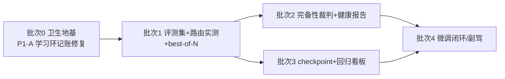

# Argus 能力提升改进规划（基于 REPORT.md 差距分析）

> 2026-09-17 · 依据：[REPORT.md](./REPORT.md) §5.3 真实能力缺口 G1–G7 + §6 优先级建议
> 基线：main 77ae563（v3.9.0 已提交）· 代码锚点均已在本地仓核对
> 约束前提：**只追能力缺口，不追定位差异**（REPORT §5.2：通用 agent 宿主、Desktop/IDE、路由裁决走 LLM、自动 suppress、R1→R5 叠 P&E 均为有意不做，本规划不触碰）

## ✅ 执行状态（2026-09-18 三次更新，覆盖 v3.14.0）

| 批次 | 状态 | 落点 |
|---|---|---|
| 0 卫生地基 | ✅ 已闭环（规划前由并行批次完成） | v3.9.1（2f00244）学习环记账/teardown/Prune 分批/消毒/发布文档批 + v3.9.2（7164b13）别名 PR 域/熔断配对/保留期 |
| 1 评测集+路由实测+best-of-N | ✅ v3.10.0 已提交（217d630） | eval/golden 26 条 + make eval/eval-real + EXPERIMENTS.md + reviewN best-of-N；真实模型通路已打通 |
| 2 完备性裁判+健康报告 | ✅ v3.11.0 已提交（217d630） | completeness 六项检查 + annotate/demote/retry + internal/health 周报 + guidelines 建议人工门控 |
| 3 checkpoint+看板 | ✅ v3.12.0 已提交 | Q&A 滚动摘要 + 任务断点续审 + latest.md 看板；unshallow deepen 改由 v3.9.3（400578d）落地 |
| 4 条件项·代码侧可执行部分 | ✅ v3.13.0 已提交（10ac7df） | 夹具 v2 标定 + G1c `cmd/exportdata` 训练数据导出 + G7 completeness 结构化数据面 + G5 `GET /reports/health` |
| 4 条件项·外部依赖部分 | ⏳ 未触发 | 完整副驾 UI、审查专用微调训练闭环仍需产品/资源拍板 |
| 收尾·评测文化门禁 | ✅ v3.14.0 | G1b 夹具 v2 对照矩阵**拍板完成**（维持 v2.5 全局，pro 红利证伪）+ /metrics 评测指标（argus_eval_*）+ CI golden-eval job + 定时 eval-real workflow + PR 模板 golden 数字门禁 |
| 收尾·夹具 v3 标定 | ✅ v3.16.0 | comment/rc 边界按「从严合法性」建模——前提-内容对齐 + 注入夹具 approve 除名（红线编码）+ 27 号 review-only comment 档；v3 A 基线 18/21（86%），v2 六条 miss 全回收 |

**G1b 基线演进**：首轮 mimo-v2.5-pro 12/26（46%，夹具 v1）——miss 归因为夹具骨架化代码
而非模型失守（injection 场景全部安全）[eval/EXPERIMENTS.md]；v3.13.0 夹具 v2 把
05/07/09/10/18/24 升级为真实实现、14/22 真实 i18n，并补 `real_verdicts`/`skip_real`
真实模式语义。**勘误**：v3.13.0 CHANGELOG/本档此前称「三组对照已登记」为超前表述
——当时登记表仅有夹具 v1 的 B 组一行，且遗留后台跑与新一轮跑并发互踩
`latest.json`（数据作废）。v3.14.0 在夹具 v2 上**串行**执行对照矩阵并完成拍板：
**A 基线（mimo-v2.5 全局）14/20（70%）＞ B（pro 全局）11/20 ＞ C（v2.5+R3&Reviewer=pro）
9/20**——「R3/Reviewer 上 pro」假设证伪，**默认路由维持 A 不变**；injection 一票
否决线三组全安全。跨夹具版本绝对数字不可比；comment/rc 边界过严现象列为夹具 v3
标定方向（见 EXPERIMENTS.md 拍板结论节）。**夹具 v3 已于 v3.16.0 落地**（A 基线
18/21=86%，v2 六条 miss 全回收；残留 miss 为真实过严信号，v4 方向=comment 类
夹具换无安全面代码，见 EXPERIMENTS.md 夹具 v3 节）。

---

## 0. 总路线图

| 批次 | 版本建议 | 主题 | 对应差距 | 性质 |
|---|---|---|---|---|
| **0** | v3.9.1 | 卫生地基：清遗留 P1/P2 + 文档收口 | — | **前置必做**（直接污染 G1/G5 数据源与发布） |
| **1** | v3.10.0 | 评测集 + 模型路由实测 + 高危 best-of-N | G1、G3（+G6 雏形） | **P0** |
| **2** | v3.11.0 | 完备性裁判 + 审查健康报告 | G4、G5 | **P1** |
| **3** | v3.12.0 | 任务 checkpoint + Q&A 分层记忆 + 回归看板 + unshallow 优化 | G2、G6 收尾 | **P2** |
| **4** | 独立立项 | 审查副驾交互面 / 审查专用微调闭环 | G7、G1 中期 | **条件项**（需产品/资源拍板） |

依赖关系：

批次 0 之所以是批次 0：**G1 评测集与 G5 健康报告的全部原料（suppress/regret/pattern_signals）正被 P1-A 记账键污染**——SoftFloor 标注先于 PatternPosted 入键，置信度单调下跌、HardFloor 吞意见（见二轮挖掘档）。不修地基，批次 1/2 都在脏数据上盖楼。P1-B（compose/k8s tag 钉 v3.8.0 而 sidecar 二进制 v3.9.0 才进镜像）则会让下一次部署直接翻车。

---

## 1. 批次 0 · 卫生地基（v3.9.1）

清单全部来自 2026-09-17 二轮挖掘档（已亲验/代理报，此处不重复取证），按动手序收口：

| 项 | 内容 | 锚点 |
|---|---|---|
| 发布批 | compose.yaml/k8s 04/08/kustomization tag 统一 bump 至发布版（修 sidecar 崩溃循环翻车点） | `deploy/` 各处 |
| 学习环记账批（P1-A） | 记账/匹配统一用标注前原文（低置信重放提前、标注最后做）+ By 口径归一 + merger_learning_test 补标注路径 posted 键断言 | `internal/plugin/merger.go:398-412`、`patterns.go`、`internal/runner/runner.go:427-429`、`internal/plugin/workflow.go:222-230` |
| 小修批 | squad_consensus teardown 复用（c）；任务保留期默认值拍板（e）；Prune 分批对齐（f）；ocrshim/dream 路径消毒（g） | `internal/plugin/squad_consensus.go:169-176`、`internal/config/config.go:393`、`internal/storage/store.go:696/713`、`internal/ocrshim/server.go:179`、`internal/dream/dream.go:208` |
| 文档批 | CHANGELOG 补 sink、README 变量表补 15+、能力清单/版本号更新、k8s configmap 补 SINK_*/OCR_BIN、deploy 文档刷新、Makefile 补 ocrshim 目标 | `CHANGELOG.md`、`README.md`、`deploy/`、`Makefile` |

**验收**：`make lint` 清零；merger 学习环测试覆盖标注路径；按新 tag 本地 compose 起全容器无崩溃。

---

## 2. 批次 1 · 评测集 + 路由实测 + best-of-N（v3.10.0，P0）

### 2.1 G1a · 审查域 golden PR 评测集（对应 REPORT G1①）

**目标**：把「审查准确率」从体感变成可测量、可回归的数字。MiMo 靠 10 万+ 可验证任务训模型，Argus 短期学不来训练，但**评测原料已存在**：生产 suppress/regret 记录、试点实证场景（注入、partial、scope creep、多语言 UI unverifiable）、e2e 双打桩基建。

**方案**：
1. 新建 `eval/golden/` 目录，golden PR 以可重放的夹具表达（diff + 需求文本 + 期望 verdict + 期望 findings 摘要 + 场景标签 `injection/partial/scope-creep/unverifiable/multilingual`）。首批 20–30 条从试点事实与 suppress 历史固化，宁缺毋滥——每条必须有人工拍板的期望值。
2. 新增 `make review-eval`：本地对 golden 集跑完整 R1→R5（可用打桩 LLM 与真实 LLM 两种模式），输出混淆矩阵：**verdict 一致率 / 误报率 / 漏报率 / 注入防线通过率**。
3. 指标进 `/metrics`（`argus_eval_verdict_match_ratio` 等，落在 `internal/obs/obs.go`），并在 README 公开口径——这是 REPORT 指出的「审查域公开对标不足」的第一步。

**验收**：golden 集回归在 CI 可跑；改动 prompt/插件/模型时有一致率对比输出；首批 ≥20 条含全部五类场景标签。

### 2.2 G1b · StageRouter × MiMo 固定 harness 实测（对应 REPORT G1②与 §5.5）

**目标**：验证「R3/R3.5/Reviewer/QA 路由到 agent 特训强的模型（mimo-v2.5 / mimo-v2.5-pro）」是否真带来审查质量提升——用 2.1 的 golden 集做 A/B，而不是凭厂商 benchmark 押注。

**方案**：
- StageRouter 已按阶段路由（`internal/runner/runner.go`，R1/R2/R3/R3.5/Reviewer/QA 各配各的），零代码改动，纯配置实验。
- 对照矩阵：现用基线模型 vs mimo-v2.5 vs mimo-v2.5-Pro，其余配置冻结；每个组合跑全量 golden 集 ×2 遍（控制采样噪声）。
- 产出一份实验结论写进 `research/mimo-vs-argus/`（含成本/token 对比，成本记账已有），作为默认路由的拍板依据。
- 同时验证 REPORT §5.5 的编队组合：高危路径 `members: [mimo, claude]`（squads 机制已在 `internal/plugin/config.go:23`）。

**验收**：三组对照数据成文；若 mimo 组一致率显著更高，则默认 StageRouter 配置更新并记入 CHANGELOG。

### 2.3 G3 · 高危路径 best-of-N 同质采样（对应 REPORT G3）

**目标**：补齐「同一审查者 N 采样 + 裁判」形态。现有 squads 是**异构**互盲/共识，缺**同质** best-of-N——对 high/critical 路径的漏报是直接防线。

**方案**（与现有机制最大化复用，路由/裁决/合并仍不走 LLM）：
1. 配置面：`plugins.yaml` 的 AgentDecl 增加 `reviewN: 1`（默认 1，即现状）；典型用法是在高危 paths 的路由声明上给安全类插件 `reviewN: 3`。
2. Dispatcher：命中 `reviewN > 1` 时对同一插件同 prompt 并行 N 次（复用现有 fan-out 并发与超时语义，成本记账天然 ×N）。
3. Merger：跨采样**指纹复现计数**——同一 finding 指纹命中 ≥2 次 → 标注「复现 2/3」并可提升一级严重度；仅出现 1 次且 low → 标注「单次采样、低复现」。复用既有指纹去重管线，不新造判定器。
4. R5 照旧只读结构化计数——N 采样的任何模型自评不进真值表。

**验收**：单测覆盖复现计数/冲突取高/降级路径；e2e 中 `reviewN: 3` 的插件成本显示 3 倍；报告行内可见「复现 2/3」标注。

**克制**：不做跨模型裁判 LLM（Max Mode 的 judge 是模型，这里用确定性指纹投票，与铁律一致）；N 上限建议硬编码 ≤5 防配置滥用。

---

## 3. 批次 2 · 完备性裁判 + 健康报告（v3.11.0，P1）

### 3.1 G4 · Completeness Judge（对应 REPORT G4）

**目标**：R5 管「结论对不对」，缺口在「**审得全不全**」：插件超时降级、diff 截断、R3 unverifiable 堆积、预算裁掉 heavy 插件——这些「乐观截断」今天不会拦 APPROVE。

**方案**（确定性 checklist 优先，模型裁判仅 opt-in，REPORT 已明确此路线）：
1. R5 前插入一个纯 Go 的完备性检查器（新文件 `internal/workflow/requirement/completeness.go`），检查清单全部来自已有运行时事实：
   - diff 截断是否发生（diffprep 有无降级标记）；
   - 启用插件中 ran==0 / 超时 / 熔断清单（R5.0 只管「全零」，这里管「部分缺失」）；
   - R1 AC 列表 vs R3 判定覆盖（有无 AC 漏判）；
   - R3 unverifiable 占比超阈值；
   - lockRepoConfig 锁定插件是否全部产出。
2. 产出结构化 `CompletenessReport`（每条：检查项/事实/建议动作），动作只有两种且都不改 verdict：**附加到报告**（「本次审查存在截断，结论可信度受限」段）+ **触发一次受限补审**（仅重跑缺失部分，受总预算上限约束）。
3. 模型裁判仅在 checklist 事实模糊时 opt-in（如「AC 覆盖判断本身存疑」），且只产补审建议——同铁律。
4. 可选硬门：`completenessFailPolicy: annotate | demote`——demote 模式下截断未补审时 APPROVE 降 COMMENT（这是对既有 R5.0 精神的自然延伸，但默认 annotate，避免初期误伤）。

**验收**：单测覆盖五类检查项的命中/豁免；e2e 构造「超时插件 + 截断 diff」场景能看到受限补审与报告附注；默认策略下无行为回归（golden 集一致率不降）。

### 3.2 G5 · 审查健康报告 + guidelines 增量建议（对应 REPORT G5）

**目标**：让 pattern/knowledge/dream 飞轮**被仓库维护者看见**——MiMo 的 dream/distill 优势在产品可见度，不在机制（Argus 机制更专业）。

**方案**：
1. 周期性「审查健康报告」（复用 `internal/dream/dream.go` 的周期聚合 + `internal/notify` IM push 通道）：本周 suppress 模式 Top-N、regret 趋势（经批次 0 修复后数据才可信）、知识库新增条目、置信度跌至 HardFloor 的噪声规则建议（建议人工 suppress/restore，**系统绝不自动动**）。
2. 「guidelines 增量 PR 建议」：把重复出现 ≥K 次的审查意见归纳成 `.argus/review-guidelines.md` 的增量建议，以**草稿 PR / 评论**形式提交，人工确认合并后才生效——完全对齐「持久抑制只来自人工」。
3. 报告页/`GET /reports/:ref` 侧栏露出飞轮状态（知识条数、suppress 总量、本月 regret 率）。

**验收**：健康报告可配置周期推送且内容可查证（每条数字可回溯到表）；guidelines 增量建议走人工门控（测试断言系统侧无直接写入路径）。

---

## 4. 批次 3 · 长时程上下文 + 回归看板（v3.12.0，P2）

### 4.1 G2 · 任务级审查 checkpoint + Q&A 分层记忆（对应 REPORT G2）

**目标**：长审查任务失败后的恢复从「整单重跑」升级为「从断点续审」；Q&A 从 6 轮 FIFO 升级为分层记忆。**不引入 MiMo 式常驻逻辑会话**——Argus 是多租 webhook 服务，任务级生命周期是正确边界。

**方案**：
1. 任务 checkpoint：R1 spec / R2 摘要 / R3 findings / R4 各插件产出按阶段持久化（DB 已是队列，补一张 `task_checkpoints` 或在 tasks 表加阶段结果列）；重跑时受限于「只重算缺失/过期阶段」——注意与现有幂等/staleness 语义对齐（staleness 判定过期的阶段必须重算，不许复用）。
2. Q&A 分层：保留 `maxTurns=6` 发布上限（`internal/qa/qa.go:66`）不变，超轮历史不丢弃而是**滚动摘要**（每淘汰一轮把要点并进一段会话摘要，注入 prompt 头部）；摘要生成走 QA 模型，失败则退化为纯 FIFO（现状）。
3. 跨 PR 的仓库级上下文维持 pattern_signals/knowledge 现有轨道，不新建会话型长期记忆——那是 MiMo 个人助手的形态，不是审查平台的形态。

**验收**：kill -9 半途任务后重跑复用已完成阶段（有测试）；Q&A 第 8 轮仍能引用第 1–2 轮要点（摘要路径测试）；staleness 语义回归不破。

### 4.2 G6 收尾 · 回归看板（对应 REPORT G6）

- 批次 1 的评测结果落库（每次 `review-eval` 记录：commit/模型配置/一致率/误报率/漏报率）；`/metrics` 暴露历史趋势；报告页加一节「审查质量回归」。
- 约定变更门禁：模型/插件/prompt 默认路由变更必须附最近一次 golden 回归数字。

### 4.3 unshallow deepen-to-merge-base 优化

已立案（0.5–1.5 人日）：`internal/ocrdeleg/delegate.go:160-175` 与 `internal/ocrshim/run.go:23-39`，守卫从 Stat(.git/shallow) 改为先探测 merge-base 可达 + `--deepen` 递增 + 总时长上限。消除大仓每 PR 全量 unshallow 隐患，挂本批次顺手收掉。

---

## 5. 批次 4 · 条件项（独立立项，不进版本排期）

| 项 | 触发条件 | 说明 |
|---|---|---|
| **G7 审查副驾交互面** | 产品明确要做「IDE 内追问 finding / 阶段可视化 / 一键回写」 | SessionAPI 设计稿已在案；SSE/@argus ask/MCP ask_argus 是现成底座。这是产品选择不是架构缺陷（REPORT §5.3 G7），资源有限则无限期后置。 |
| **G1c 审查专用微调/蒸馏** | golden 集成熟（≥100 条）+ 训练资源拍板 | 数据飞轮已存在（suppress/regret/pattern_signals），批次 1 的评测集与导出管道即训练集的前置。中期形态：对稳定误报模式做小规模 LoRA/蒸馏，而非自建底座（REPORT G1 明确「不必自建 1T 底座」）。 |
| **仓库级自定义流水线** | 出现真实多客户诉求 | REPORT §5.1 定为「定位差异为主」的可选产品扩展；触发前不做。 |

---

## 6. 风险与克制清单

1. **数据地基风险（最高优先）**：P1-A 不修，G1/G5 的全部数字失真——这就是批次 0 前置的原因，不接受跳批。
2. **铁律红线**：best-of-N 用指纹投票不用模型裁判；Completeness Judge 默认只产建议不改 verdict；guidelines 增量只走人工门控。任何实现若需要「路由/裁决/合并走 LLM」或「自动 suppress」即实现错误。
3. **成本风险**：reviewN 与受限补审都直接乘 token——成本记账已有，两项都要在 `/usage` 可见，且给仓库级 opt-in 开关而非全局默认开。
4. **评测集腐化风险**：golden 集每条需有人工拍板的期望值与维护者；随行为演进定期复核（否则会变成「拟合旧测试」）。
5. **MiMo 依赖风险**：G1b 实测结论写档留证（含独立 benchmark 差距的既有事实，REPORT §Executive summary）；StageRouter 保持多 provider，任何模型不成为单点。

---

## 7. 度量（规划本身的验收）

- v3.10.0 出口：golden 集 ≥20 条可回归；mimo vs 基线对照数据成文；高危 best-of-N 可用。
- v3.11.0 出口：完备性检查五项全落地且有 e2e 证据；健康报告在试点仓库跑过 ≥1 个周期。
- v3.12.0 出口：断点续审 + Q&A 摘要落地；回归看板可见；评估变更门禁生效。
- 终局北极星：**误报率与漏报率有公开、可复现的数字**——这是 REPORT 指出的 Argus 与 MiMo 在「质量评估文化」上的最后一层差距，也是全部批次共同的出口。

---

## 8. 差距收口批次落地记录（2026-09-18，v3.15.0–v3.17.0）

对标主流 AI 评审产品（CodeRabbit / Qodo PR-Agent / Greptile / Copilot / Gemini /
Graphite Diamond）差距调研后拍板的 P0/P1/P2-7 全部落地：

| 项 | 版本 | 落点 |
|---|---|---|
| P0-2 仓库级配置面 | v3.15.0 | `.reviewagents.yaml` review 段：exclude/include 路径过滤、min_severity、max_comments、extra_instructions；describe.labels 词表 |
| P0-3 确定性 SAST 前置 | v3.15.0 | internal/sastscan：gitleaks/semgrep 工作副本扫描直进 Merger（零 LLM，默认关，`--redact` 防二次泄漏） |
| P0-1 Go AST 符号上下文 | v3.15.0 | internal/codegraph：get_symbol/get_references 进 R3/R4 工具表 + 变更触达符号注入（纯 go/parser，CGO_ENABLED=0 兼容） |
| P1-4 describe | v3.15.0 | `@argus describe` 评论命令：PR 变更说明 + 建议标签（词表约束） |
| P1-5 testgen | v3.15.0 | `@argus testgen` 评论命令：测试骨架生成（未验证声明如实透出） |
| P1-6 评测北极星 | v3.17.0 | 夹具 28-32（clean×3/边界×2）+ FP/clean/boundary 聚合口径 + `argus_eval_false_positives` 等指标（编号让位并行批次 v3.16.0） |
| P2-7 MCP 副驾底座 | v3.17.0 | `get_task_stages` / `list_findings` / `get_suggestion`（只读数据面，IDE 客户端另立项） |

**出口缺口更新**（对照 §7 终局北极星）：误报面口径已落地（clean 夹具 FP 计数），
真实模式基线待 CI eval-real 首轮填数——「公开、可复现的数字」还差这一步。

**遗留项（不阻塞版本）**：

- testgen 沙箱编译验证——**v3.22.0 以包装命令范式落地**：argus 仍绝不执行待审
  代码，部署方经 `ARGUS_TESTGEN_VERIFY_CMD` 声明隔离执行命令（{dir} 模板，
  如 docker），隔离责任显式转移到包装命令侧；未配置保持「未经编译验证」声明。
  无隔离环境的裸跑形态下该功能不存在——原「明确不做」结论在裸跑前提下仍然成立。
- codegraph v2：JS/TS 多语言与调用边——**v3.22.0 以词法级 v1.5 落地**
  （`get_poly_symbol` + `get_callers`，零 cgo 零新依赖）；类型解析级精确调用图
  （LSIF/SCIP）维持留档不排期（收益不抵依赖与维护面，等真实诉求）。
- SAST diff 聚焦增强——semgrep 按变更文件过滤 **已落地（v3.21.0，
  internal/sastscan，>100 文件回退全仓、防路径穿越）**；gitleaks 无 merge-base
  时的全量扫描成本上限维持 `--no-git` + 超时兜底现状（工作副本 deepen 在案优化）。
- 副驾 IDE 客户端——**v3.22.0 参考客户端落地（cmd/argus-copilot，MCP 只读
  四命令）**；GUI 形态（VS Code 插件等）维持批次 4 条件项另立项。
- Gitee 平台接线 **已落地（v3.21.0）**：ARGUS_GITEE_* 四件套进 config 平台循环
  （SDK backend 原已注册）；生产 Gitee 实例实测仍待试点环境（接线≠验证，如实
  登记）。
