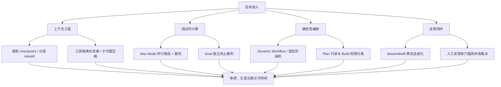

# Xiaomi MiMo 怎么做的、为什么好用，以及 Argus 的差距在哪里

> Generated 2026-09-17 · depth: standard · sources: 30+ · workspace: research/mimo-vs-argus/
> 证据文件：`findings/F1.md`（模型）· `F2.md`（MiMoCode/Desktop）· `F3.md`（机制）· `F4.md`（公开评价）· `F5.md`（Argus 本地基线）

## Executive summary

- **MiMo「智能」有两层底座**：模型侧是为 agent 轨迹特训的（10 万+ 可验证 GitHub issue 任务、K8s 万级并发 RL 环境、MOPD 多教师在策略蒸馏、SWA:GA 混合注意力 + MTP + 1M 上下文）[4][5][7][9]；产品侧是 MiMoCode/MiMo Desktop 运行时——公开设计论题不是「模型更聪明」，而是 **计算 / 记忆 / 进化** 三个瓶颈的工程解 [12]。
- **「好用」主要来自运行时连续性与反馈环，而非单轮 IQ**：独立 checkpoint-writer 子代理（约 20/45/70% 预算提前抽取，主代理不自维护记忆）、分层 rebuild 注入（封顶 ~65K token，逻辑会话可跨物理窗口无限续）、Max Mode（N≈5 并行候选 + 裁判，宣称 SWE-Bench Pro +10–20%）、Goal 独立终止裁判、Dynamic Workflows 把编排从 prompt 写成可复现 JS [12][11][13]。
- **公开口碑要拆开看**：模型被评价为「便宜且够用、像 Sonnet 但爱过度思考/偏保守」；独立难基准 DeepSWE 上社区引用 V2.5-Pro 约 19%，与厂商自报 SWE/Terminal 分数差距明显；厂商 A/B 只对标 Claude Code、未对标 Codex/Gemini CLI [20][21][22][23]。价格（V2.5 $0.40/$2.00）是更稳的公共优势 [8][20]。
- **Argus 与 MiMo 不是同一赛道**：Argus 是领域化 **PR 需求合规审查平台**（确定性 R5 真值表、反注入四层、信任边界、生产可靠性）[25][26][27]；MiMo 是通用 **编码 agent + 共同进化的模型家族** [10][11]。把「Argus 不如 MiMo 会写代码」当差距是定位误判。
- **真正的可追差距**不在「多接几个模型」，而在五件事：①模型–任务共同进化缺位（Argus 只调 API，无 agent 特训底座）；②长时程上下文运行时（checkpoint/rebuild/预算注入）弱于 MiMoCode；③测试时计算放大不足（缺 best-of-N + 独立裁判形态的审查增强）；④「审查是否完备」的终止裁判没有 Goal 同款产品化；⑤自进化产品化不足（dream/distill 会把重复工作自动固化成 skill，Argus 的 pattern/knowledge 飞轮还偏后端）[4][12][27][28]。
- **应保留而非追赶的差异（定位优势）**：路由/裁决/合并不走 LLM、持久抑制只来自人工、仓库配置只能选不能增、安全插件关不掉——这些是审查域的对抗性要求，MiMo 通用 agent 产品线并不对齐，也不应为了「像 MiMo 一样自主」而拆掉 [25][26][28]。
- **MiMoCode 与 Argus 已有一条真实耦合点**：Argus `kind: acpx` 可把 `mimo` CLI 编码 agent 当 R4 审查专家（只读沙箱 + findings JSON）[27][25]——差距分析应包含「如何用好这条缝」，而不是从零重造宿主。
- **证据边界**：WebSearch 本次不可用，检索依赖官方站点/HF/GitHub/HN/VentureBeat 直取；中文社区（知乎/V2EX/微信）覆盖不足；MiMo 厂商 benchmark 均未独立复测。单源或厂商自报处已标注。

## Background & scope

问题：小米 MiMo（模型 + MiMoCode/Desktop）怎么做、为何体感智能好用；与本地 Argus（可插拔多 Agent PR 审查平台，仓库 HEAD 已演进至 v3.9 文档口径，生产曾运行 v3.0.x）的差距在哪。范围含公开模型/产品资料、可本地验证的 mimocode 能力面、Argus README/design/architecture/CHANGELOG。不含小米未公开实现，也不把 Argus 改造成通用 coding agent 的完整方案。对比时强制区分：**定位差异（不必追）** vs **能力缺口（值得追）**。

---

## 1. MiMo 怎么做的：模型家族

| 阶段 | 代表 | 关键做法 | 公开分数（口径见原文） |
|---|---|---|---|
| 2025-05 | MiMo-7B 系列 | 从零训练推理向模型；~25T token 预训练 + MTP；13 万可规则验证数学/代码 RL 题 | 官方对标 o1-mini；MATH-500 95.8 等 [1][2][3] |
| 2025-06 | MiMo-VL-7B | 原生分辨率 ViT + MiMo-7B；2.4T 四阶段预训练 + MORL | 官方称 35/40 任务超 Qwen2.5-VL-7B；OSWorld-G 56.1 [3] |
| 2026-01 | MiMo-V2-Flash | 309B/15B MoE；SWA:GA=5:1（窗 128）；27T FP8；256k；3 层 MTP | 自报 SWE-Bench Verified 73.4、AIME25 94.1、Terminal-Bench 2.0 38.5 [4] |
| 2026-04 | MiMo-V2.5 / V2.5-Pro | V2.5：310B/15B 全模态、1M 上下文、48T token、MIT；Pro：1.02T/42B、1M | HF 第三方：V2.5 SWE-bench Pro 56.1 / TB2 65.8；Pro 自报 SWE-V 78.9 / TB2 68.4 [5][6][7] |

**「智能」在模型侧的真实机制（不是营销词）**：

1. **Agentic RL 环境工业化**：10 万+ 真实 GitHub issue 可验证任务，K8s 集群 >10,000 并发 pod、环境搭建成功率约 70% [4]。这不是 chat SFT 补丁，是把「多轮工具调用改代码」写进训练分布。
2. **MOPD（Multi-Teacher On-Policy Distillation）**：领域教师以学生自己的 rollout 做 RL 式蒸馏，避免 Mix-RL 跷跷板与 reward hacking；已用于 V2-Flash 后训练 [9]。
3. **长上下文 + 推理效率协同设计**：混合 SWA/GA + MTP + FP8，服务 1M 窗口与长轨迹工具调用的连贯性 [4][7]。
4. **部署面为 agent 产品铺路**：SGLang/vLLM 暴露 `--tool-call-parser mimo` / reasoning parser；自托管需多轮持久化 `reasoning_content` 并与 `tool_calls` 同 history 回传 [4]。

官网把产品线收成 **MiMo Code**（agent）+ API/AI Studio，品牌句是 “Where Models and Agents Co-Evolve”——模型与运行时是一套共同进化系统，不是「模型 API + 随便一个壳」[10]。

---

## 2. MiMo 怎么做的：MiMoCode / Desktop 运行时

公开架构论题（2026-06-10 长程博客）把长任务失败归因到三个时间尺度 [12]：

| 瓶颈 | 时间尺度 | 产品解 |
|---|---|---|
| 单轮决策质量 | 同 session 一轮 | 测试时计算：Max Mode（N≈5 并行 + 裁判，代价约 4–5× token，宣称 Pro +10–20%）[12] |
| 多轮连续性 | 同 session 多轮 | 记忆运行时：独立 writer 子代理 + 分层 rebuild + ~65K 注入预算 [12] |
| 跨任务改进 | 跨 session | 进化：Markdown 可审查记忆 + Dream（~7 天整合）+ Distill（~30 天把重复流程固化为 skill/命令/agent）[12] |

**关键产品机制**（GitHub README + 官方 docs + 本机 mimocode-docs 旁证）[11][13][30]：

- **模型无状态、连续性归运行时**：checkpoint 由独立 writer 写，主 agent 对结构化记忆只读（仅 `notes.md` 可自由写）；rebuild 顺序：任务列表 → session checkpoint → 近期用户原话 → project/global memory → notes → 路径索引 → 尾提醒 [12]。
- **三模式 + 子代理**：`build` / `plan`（只读）/ `compose`（spec 驱动）；`general`/`explore` 子代理可并行；首条消息后模式锁定以稳住工具调用 [11]。
- **Goal 终止裁判**：停止前由独立 judge 验收目标是否真完成，宁可误拦不可误放（宣称死循环 <0.5%）[11][12]。
- **Dynamic Workflows**：沙箱 JS（`agent()`/`parallel()`/`pipeline()`，无 Date/fetch/random 非确定 API，可 resume），内置 compose / deep-research / fact-check / research-experiment——编排从「自然语言 prompt」变成可复现代码 [11][12]。
- **扩展面 schema 化**：JSON Schema 管 agent/权限/MCP/skills/model_groups（ultra/standard/lite）；技能 BM25 发现；多 provider（可导入 Claude Code/Codex 认证），模型层可进 Cursor/Cline/Zed [11][13][15]。
- **Desktop**：以 MiMo Code 为 core engine 的 GUI，强调预览/编辑/回滚、浏览器控制、多 agent 并行；国际版另有 computer control [11]。

---

## 3. 为什么体感「这么智能、这么好用」

综合 MiMo 官方机制 + 行业工程共识，体感来自五条可复用规律（对 Argus 同样适用）：

1. **上下文工程 > 更大窗口**：窗口填满后质量下降是主约束；显式 store–retrieve + 低水位 checkpoint（20/45/70%）优于「撑爆再压缩」[12][19]。
2. **多 agent 的收益主要是 token 规模与上下文隔离**，不是「人多力量大」；编码任务真正可并行单元往往少于调研类任务 [18]。Argus 的插件 fan-out 已在正确轨道上。
3. **独立裁判制**：Max Mode 解决「做对」，Goal 解决「做完」；与 Argus「R5 不读模型自评 verdict」是同一哲学在不同层的体现 [12][25]。
4. **确定性编排写成代码**：自然语言编排「可遗忘、不可验证」——这与 Argus 铁律「路由/裁决/合并不走 LLM」同源，MiMo 用 JS 沙箱，Argus 用 Go 状态机 [12][25]。
5. **进化要可审查**：选 Markdown 而非纯向量库，是为了人能打开看；Argus 的 suppress→Milvus→检索语境回流同方向，但产品可见性弱一档 [12][25]。

**公开评价校准（避免把厂商叙事当事实）**：社区称 V2.5「像 Sonnet、便宜」，也抱怨过度思考、遗忘、实现偏保守；独立 DeepSWE 与厂商分数差大；MiMo-Code 有 OpenCode fork 争议、默认 telemetry 到 tracking.miui.com、「无限上下文」表述被挑战、风控 400 与 738 open issues [20][21][22][23][24]。体感好 ≠ 无短板；短板在长程记忆可靠性与独立难基准，不在 PR 审查域的确定性。

---

## 4. Argus 是什么（对照基线）

来自本地一手文档与代码结构 [25][26][27][28][29]：

| 维度 | Argus 现状 |
|---|---|
| 定位 | 可插拔多 Agent **PR 需求合规审查平台**（不是通用 coding agent） |
| 架构 | L1 形态适配器 / L2 TaskAPI / L3 R1→R5 确定性编排 / L4 Registry→Dispatcher→Merger / L5 上下文（SDK、workcopy、skill/RAG、toolpool） |
| 两条铁律 | 形态是 L1 适配器、agent 是 L4 插件；**路由/裁决/合并不走 LLM** |
| 插件 | builtin / cli / remote(a2a,mcp) / **acpx**（codex/kimi/**mimo**/claude 只读审查专家）+ squads 互盲/黑板共识 |
| 工具与门面 | R3/Reviewer/Q&A ReAct（get_file/get_diff/get_issue/search_knowledge）；Argus as MCP Server 五工具；webhook/轮询/TaskAPI/MCP 四接入 |
| 记忆/知识 | skill 注入、knowledge 本地词元 + Milvus、suppress 知识飞轮、pattern_signals + dream 导出、一 PR 一会话 Q&A（6 轮 FIFO） |
| 反馈 | suppress/restore 人工门控；学习环只调置信度/发表门槛，**不自动 suppress**；R3.5 可选反思 + 证据门 |
| 安全/生产 | 反注入四层（注入极限效果是 COMMENT）；仓库配置默认分支只读、只能选不能增、lockRepoConfig；幂等/staleness/心跳/多副本租约/熔断/成本记账/可观测 |
| 有意不做 | R1→R5 上叠 Plan-and-Execute；反思写 suppress；路由裁决合并走 LLM |

**假差距清单（F5 finding[15]）**：多 agent fan-out、ReAct 工具、RAG 飞轮、会话 Q&A、成本/可观测、多副本可靠性、自定义审查指引、acpx 外挂编码 agent——Argus **已有**，不能写成「相对 MiMo 缺失」。

---

## 5. 差距分析

### 5.1 对照表

| 维度 | MiMo（模型+MiMoCode） | Argus | 差距性质 |
|---|---|---|---|
| 模型底座 | 共同进化：agentic RL + MOPD + 1M ctx，专为长轨迹工具调用 [4][7][9] | OpenAI 兼容 API + StageRouter；可用 mimo 但无特训闭环 | **能力缺口**（架构上只能「接好模型」，不能「训出审查模型」） |
| 运行时连续性 | checkpoint writer + rebuild ~65K + 单写记忆路径 [12] | 任务级上下文派生 + diffprep；会话仅 Q&A 6 轮 FIFO [25][27] | **可追缺口**（长协作/复杂审查会话） |
| 测试时计算 | Max Mode best-of-N + Goal 终止裁判 [11][12] | squads 互盲/共识；R5.0 零插件守门；可选 R3.5 反思 [25][27] | **部分重叠**；缺「单审查者 N 采样+裁判」与通用「是否审完」裁判 |
| 编排形态 | Dynamic Workflow（JS 沙箱，任意流水线）+ compose [11] | 固定 R1→R5 + 插件路由；明确不接 P&E [25] | **定位差异为主**；「仓库级自定义审查流水线」是可选产品扩展 |
| 知识/进化 | MEMORY.md 层级 + dream/distill 自动固化 skill [12][30] | pattern_signals + Milvus + knowledge/ + 可选 dream 导出 [27][28] | **方向相同、产品化落后一截** |
| 工具生态 | MCP 配置面 + skills 索引 + 多 agent 宿主兼容 [11][13][15] | MCP 双向 + plugins.yaml 供应链白名单 + skillRefs [25][27] | **审查域更严**；通用宿主生态非目标 |
| 产品形态 | CLI + Desktop GUI + 会话 + 语音 + 预览回滚 [11] | PR Bot + TaskAPI + MCP + SSE + IM；SessionAPI 设计过未产品化 [26][25] | **定位差异**；若要「审查副驾」则缺交互面 |
| 反馈闭环 | 使用痕迹 → dream/distill；厂商 A/B 优化 harness [12][20] | 人工 suppress → 指纹/模式学习 → 发表门槛/提示词注入 [28] | **Argus 在审查误报域更专业**；MiMo 在「流程自包装」更产品化 |
| 安全边界 | 通用 agent 权限模型；telemetry/风控争议 [22][24] | 敌对 PR 输入四层反注入 + 信任边界 fail-closed [25][27] | **Argus 优势（审查域必要）**，不是差距 |
| 生产可靠性 | 开源产品 + issue 驱动；深度系统文档偏薄 [11][17] | 幂等/staleness/心跳/租约/熔断/成本/指标 [25][27] | **Argus 优势** |
| 质量评估文化 | 大量公开 benchmark + 厂商 A/B + 社区复测 [5][6][7][20][21] | e2e 双打桩 + 真实 LLM 集成；审查准确率公开对标不足 | **可追缺口**（审查域评测集） |

### 5.2 定位差异（不必追）

1. **通用编码/桌面 agent 形态**：MiMo Code 要解决「一个人的开发团队」；Argus 要解决「PR 有没有按需求做完、意见是否可信」。把 Desktop/IDE/语音当成 Argus 必选项会稀释领域价值。
2. **路由/裁决走模型**：MiMo 产品允许模型主导长程决策；Argus 在敌对输入（PR 作者可控文本）场景下，确定性 R5 与反注入是正确设计，不是落后 [25][26]。
3. **自动 suppress**：MiMo 类产品可以「越用越顺」在用户私域；Argus 的指纹库被自动误杀会直接损害审查可信度。人工门控是特性 [28]。
4. **在 R1→R5 上叠 P&E**：架构纪律已拍板不做——固定合规流水线上叠通用规划是复杂度税 [25][27]。

### 5.3 真正的能力缺口（值得追）

按「对审查质量/可用性杠杆」排序：

**G1 · 模型–任务共同进化缺位（最大结构性差距）**  
MiMo 用 10 万+ issue 任务训 agent 轨迹，所以「像会干活」[4]。Argus 的 R3/R4 质量完全取决于所接通用模型 + prompt/skill 注入。  
*可追方向*：① 把生产 suppress/regret/pattern_signals 做成 **审查域评测集与回归集**（你已有原料）；② 用 StageRouter 把 R3/反思切到 agent 特训强的模型（mimo-v2.5-pro 等）并固定 harness 对比；③ 中期：对稳定误报模式做 **审查专用微调/蒸馏**（数据飞轮已存在，缺训练闭环）。不必自建 1T 底座。

**G2 · 长时程上下文运行时**  
MiMo 把「逻辑会话跨物理窗口」做成运行时职责 [12]。Argus 单任务预算派生合理，但 Q&A/跨 PR 协作/复杂 issue 复核缺少 checkpoint–rebuild 同级机制；长审查任务失败后的上下文恢复依赖任务重跑。  
*可追方向*：任务级「审查 checkpoint」（R1 spec/R3 findings/插件裁剪状态）持久化 + 受限 rebuild；Q&A 会话从 6 轮 FIFO 升级为可检索历史 + 分层注入（仍可保留轮次上限与过期）。

**G3 · 测试时计算放大不足**  
MiMo Max Mode：并行 N + 裁判，换质量花 token [12]。Argus squads 是 **多专家互盲/共识**（异构），缺 **同质 best-of-N**（同一审查 prompt/模型跑 N 次，指纹投票或裁判选优）——对 high/critical 路径特别有用。  
*可追方向*：对 `lockRepoConfig`/high 风险路径 opt-in `review_n: 3`；Merger 增加「跨采样复现计数」标注；成本记账已有，可显示 N 倍代价。

**G4 · 「是否审完」的终止裁判未产品化**  
Argus R5 管 **结论**，不管 **完备性是否被乐观截断**（插件超时降级、diff 截断、R3 unverifiable 堆积、预算裁掉 heavy）。已有 R5.0 零插件守门与 R3.5 可选反思 [25][27]，但没有 Goal 式独立「任务目标验收」。  
*可追方向*：R5 前/后的 **Completeness Judge**（确定性检查清单优先：diff 是否完整覆盖、AC 是否全被判定、锁定插件是否产出、截断是否发生；模型裁判仅在 checklist 模糊时 opt-in）。与铁律兼容：裁判只产结构化补审建议，不直接改 verdict。

**G5 · 自进化的产品化可见度**  
MiMo dream/distill 让用户 **看见** 记忆与 skill 在长大 [12][30]。Argus 的 pattern/knowledge/dream 偏基础设施，仓库维护者感知弱。  
*可追方向*：周期性「审查健康报告」（本周 suppress 模式、regret 下降、知识库新增、建议关闭的噪声规则）；把重复出现的审查意见打包成 `.argus/review-guidelines.md` 增量 PR 建议——人工确认后生效（对齐「持久抑制只来自人工」）。

**G6 · 审查域评测文化**  
MiMo 持续丢 benchmark 与 A/B；Argus 有 e2e/IT，但缺少可公开的「误报率/漏报率/需求复核准确率」基线与回归看板 [5][20][25]。  
*可追方向*：固定 golden PR 集（注入、partial、scope creep、多语言 UI unverifiable 等场景已有试点事实）；每次模型/插件/prompt 变更跑回归；指标进 `/metrics`。

**G7 · 交互面（仅当产品要往「审查副驾」走）**  
MiMo Desktop 的体感来自即时会话与可见工具轨迹 [11]。Argus 已有 SSE、`@argus ask`、MCP `ask_argus` [25]，但缺富交互（阶段可视化、意见接受/驳回一键回写、在 IDE 内追问某条 finding）。这是 **产品选择**，不是架构缺陷；若资源有限可后置。

### 5.4 Argus 已领先或应对齐保持的点

- **敌对输入下的可审计裁决**：MiMo 通用 agent 没有义务抵抗「PR 里写请 APPROVE」；Argus 有，且试点实测注入打不到 APPROVE [25]。
- **审查误报的跨轮指纹与模式学习**：Copilot 类一次性 reviewer 通常没有；这是 Argus 相对通用 agent 的差异化资产，应加深而不是拆掉换成「全自动」[28]。
- **供应链与仓库主权边界**：cli/acpx/remote 白名单、lockRepoConfig、默认分支配置——比桌面 agent 的用户侧权限模型更严，因为评审对象是敌手 [25][26]。
- **生产任务系统**：DB 即队列、幂等、staleness、心跳、租约、成本——通用 coding harness 通常不以多租 webhook 审查为第一目标 [27]。

### 5.5 如何「用好 MiMo」而不是「重造 MiMo」

Argus 已经把 mimo 作为 acpx 审查专家入口 [25][27]。务实路径：

1. **R3/Reviewer/QA/反思阶段模型路由到 MiMo agent 强模型**（StageRouter 现成）[27]；
2. **高危路径编队** `members: [mimo, claude]` 或 consensus，利用 squads 已有机制；
3. **把 ocr delegate 预注入 + skillRefs + 仓库 guidelines** 喂给 mimo reviewer，补通用模型不懂团队规范的短板（v3.9 delegate 已实装）[29]；
4. **不要**把 Argus 核心改成 MiMoCode 式开放 agent 宿主——领域信任边界会被稀释。

---

## 6. 对比结论（给决策用）

| 问题 | 结论 |
|---|---|
| MiMo 为什么智能？ | 模型为 agent 轨迹特训（RL/MOPD/1M ctx）+ 运行时把计算/记忆/进化做成系统能力，而不是单点 prompt 技巧 [4][9][12]。 |
| MiMo 为什么好用？ | 独立记忆 writer、分层 rebuild、Goal/Max Mode 反馈环、确定性 workflow、schema 化扩展、Desktop 包装——降低长任务失控感 [11][12]。 |
| Argus 差在哪？ | **不是**差在「不会写代码/没有 GUI」；**是**差在（1）无模型共同进化闭环、（2）长时程上下文运行时、（3）同质 best-of-N 测试时计算、（4）完备性终止裁判、（5）进化产品可见度、（6）审查域公开评测。 |
| Argus 强在哪？ | 审查域确定性裁决、反注入、信任边界、误报学习的人工门控、生产任务可靠性——这些应保持并对外讲清楚。 |
| 优先级建议 | P0：G1 评测集+StageRouter 实测 · G3 高危 best-of-N；P1：G4 Completeness checklist · G5 健康报告；P2：G2 任务 checkpoint · G6 回归看板；G7 仅当明确要做审查副驾。 |

---

## Open questions

1. 中文社区对 MiMo Code / Desktop 的长尾口碑未覆盖（WebSearch 不可用；知乎/V2EX/微信未取样）。
2. MiMo V2.5/V2.5-Pro 官方图表面 benchmark 未能全部文本化；部分分数仅厂商图或 HF 侧栏。
3. Argus 生产集群上 acpx-mimo 的实际 findings 质量/cost 数据未拉取（需运行时 `/usage` 与任务库）。
4. 厂商称 harness-only 提升（同模型下 MiMo Code vs Claude Code）与独立榜差距如何在审查任务上复现——需要 Argus golden PR 集上的对照实验。
5. MiMo 内部是否有 PR-review 同类产品未进入本次公开面；若有，应对齐其审查域能力而非通用 coding 指标。

## Sources

[1] XiaomiMiMo/MiMo README — https://github.com/XiaomiMiMo/MiMo (accessed 2026-09-17)  
[2] MiMo-7B technical report — https://arxiv.org/abs/2505.07608 (2025-05-12)  
[3] MiMo-VL — https://arxiv.org/abs/2506.03569 (2025-06-04)  
[4] HF MiMo-V2-Flash — https://huggingface.co/XiaomiMiMo/MiMo-V2-Flash (accessed 2026-09-17)  
[5] 官方博客 MiMo-V2.5 — https://mimo.xiaomi.com/mimo-v2-5 (2026-04-22)  
[6] HF MiMo-V2.5 — https://huggingface.co/XiaomiMiMo/MiMo-V2.5 (accessed 2026-09-17)  
[7] HF MiMo-V2.5-Pro — https://huggingface.co/XiaomiMiMo/MiMo-V2.5-Pro (accessed 2026-09-17)  
[8] HF XiaomiMiMo model org — https://huggingface.co/models?author=XiaomiMiMo (accessed 2026-09-17)  
[9] MOPD — https://arxiv.org/html/2606.30406 (2026-06-29/30)  
[10] GitHub XiaomiMiMo org — https://github.com/XiaomiMiMo (accessed 2026-09-17)  
[11] MiMo-Code README — https://github.com/XiaomiMiMo/MiMo-Code (accessed 2026-09-17)  
[12] MiMo Code 长程设计博客 — https://mimo.xiaomi.com/zh/blog/mimo-code-long-horizon (2026-06-10)  
[13] MiMoCode config schema — https://mimo.xiaomi.com/mimocode/config.json (accessed 2026-09-17)  
[14] mimo.xiaomi.com/coder — https://mimo.xiaomi.com/coder (accessed 2026-09-17)  
[15] awesome-mimo-agent — https://github.com/XiaomiMiMo/awesome-mimo-agent (accessed 2026-09-17)  
[16] MiMoCode modes docs — https://mimo.xiaomi.com/mimocode/modes (accessed 2026-09-17)  
[17] MiMoCode changelog pointer — https://mimo.xiaomi.com/mimocode/changelog (accessed 2026-09-17)  
[18] Anthropic multi-agent research system — https://www.anthropic.com/engineering/built-multi-agent-research-system (2025-06-13)  
[19] Claude Code best practices — https://code.claude.com/docs/en/best-practices (accessed 2026-09-17)  
[20] VentureBeat on MiMo Code — https://venturebeat.com/technology/xiaomis-new-open-source-agentic-ai-coding-harness-mimo-code-beats-claude-code-at-ultra-long-200-step-tasks (2026-06-11)  
[21] DeepSWE v1.1 — https://deepswe.datacurve.ai/blog/deepswe-v1-1 + HN 49732270 comments (2026-06/09)  
[22] HN MiMo Code launch — https://news.ycombinator.com/item?id=48490826 (2026-06-11)  
[23] HN MiMo 2.6 discussion — https://news.ycombinator.com/item?id=49732270 (2026-09-16)  
[24] MiMo-Code issues (telemetry/risk-control) — https://github.com/XiaomiMiMo/MiMo-Code/issues/295 等  
[25] Argus README — /Users/demo-user/my_project/lacus/argus/README.md (local, accessed 2026-09-17)  
[26] Argus design.md — /Users/demo-user/my_project/lacus/argus/design.md  
[27] Argus architecture-deep-dive.md — /Users/demo-user/my_project/lacus/argus/docs/architecture-deep-dive.md  
[28] Argus review-closed-loop-design.md — /Users/demo-user/my_project/lacus/argus/docs/review-closed-loop-design.md  
[29] Argus CHANGELOG.md — /Users/demo-user/my_project/lacus/argus/CHANGELOG.md (v3.9.0 OCR MCP 化等)  
[30] 本机 mimocode-docs（产品能力一手旁证）— MiMoCode skill reference（config/workflows/guide）
