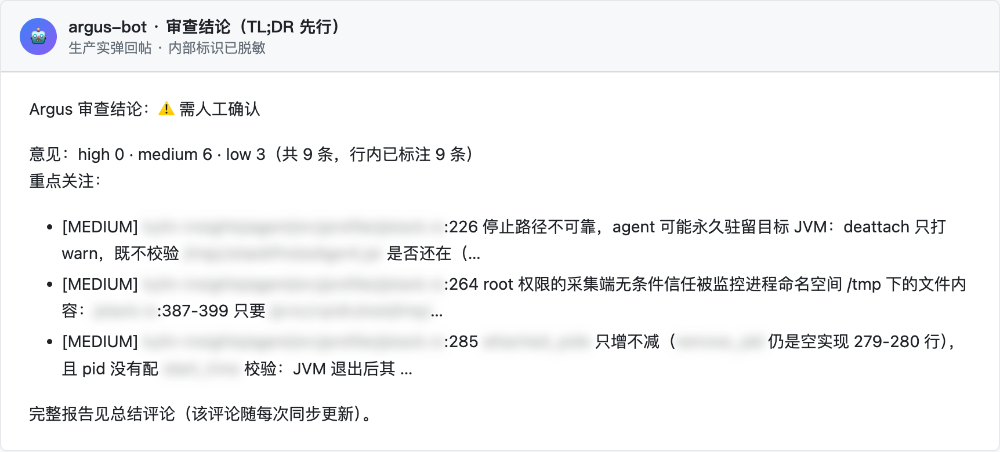
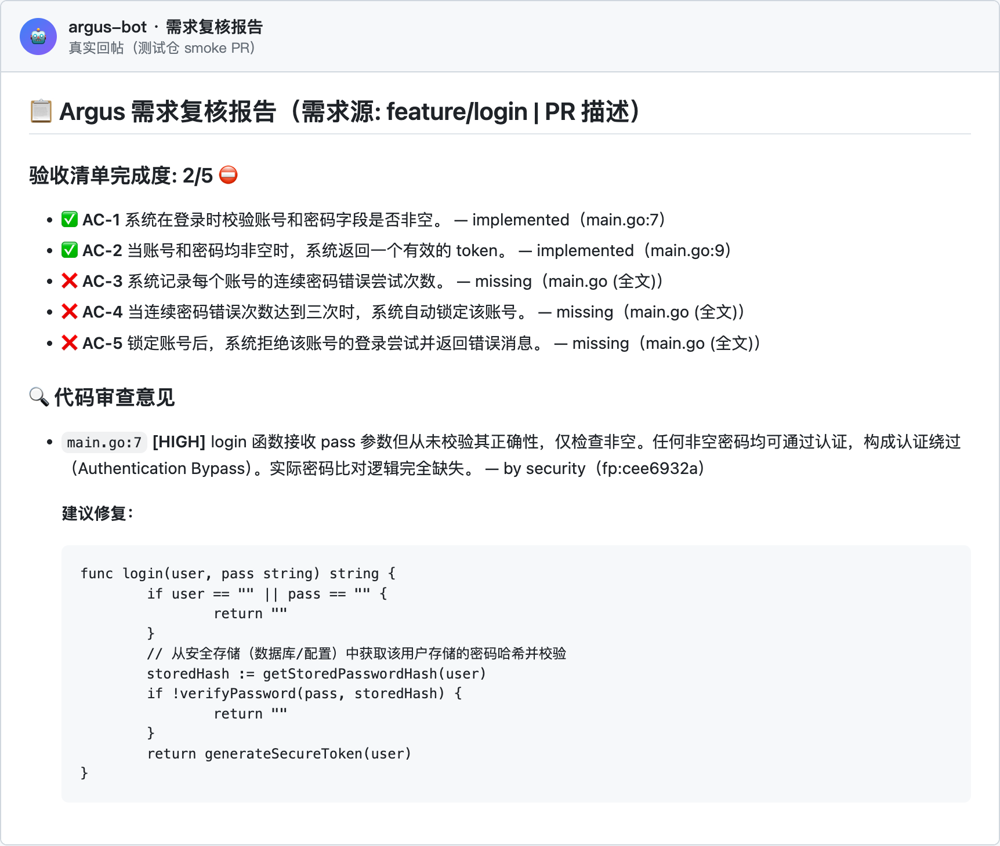
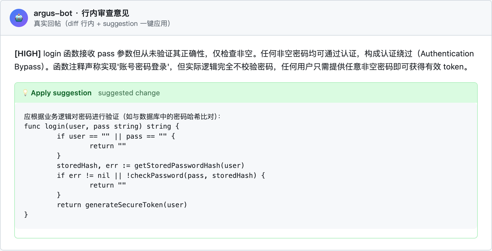
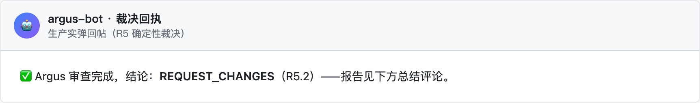
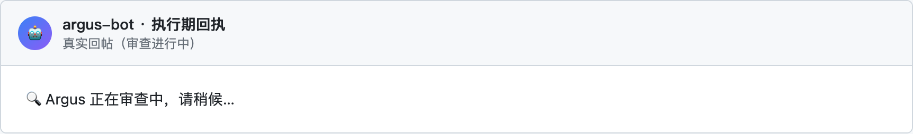
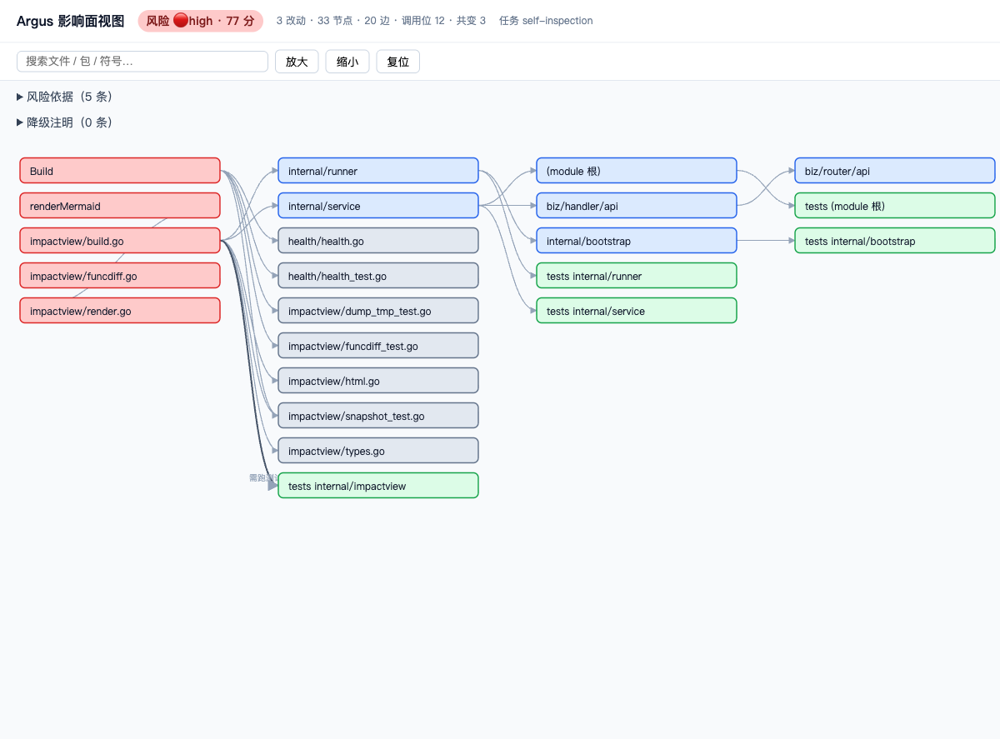
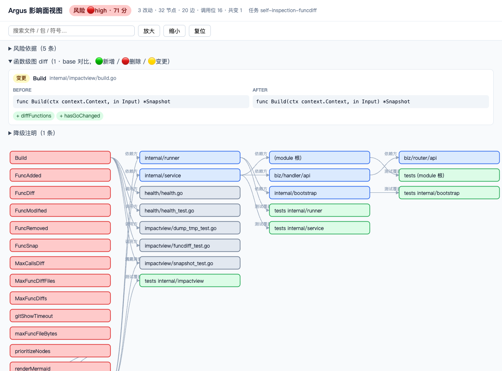
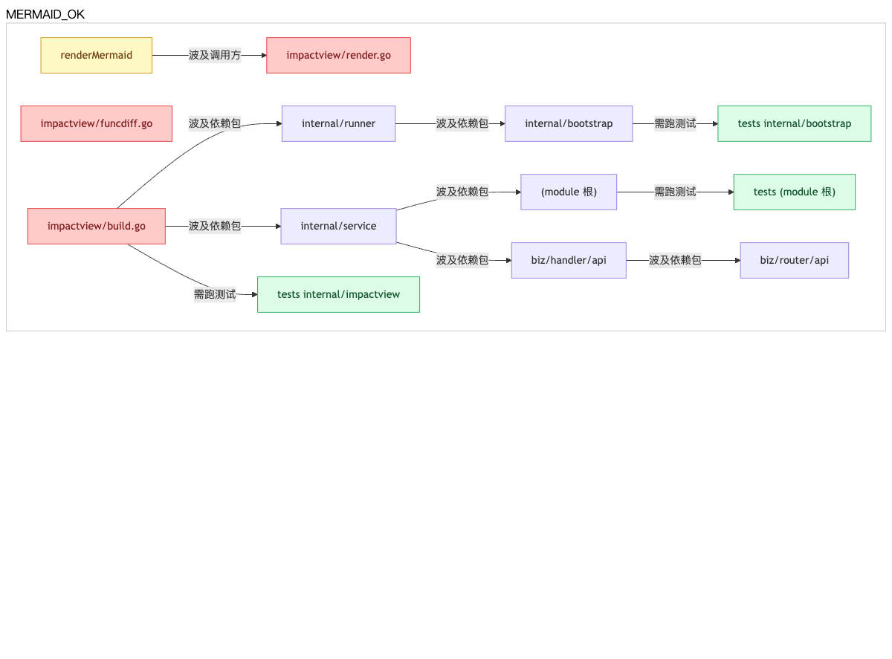

<div class="chips" style="justify-content:center; margin-top:-8px">
<code>Gitea · Forgejo · GitHub · GitLab · Gitee · GitCode · 腾讯工蜂</code>
<code>单二进制 · 本地化部署</code>
<code>MCP 原生 · 24 工具</code>
<code>Apache-2.0</code>
</div>

<div class="stats">
<div><div class="num">24</div><div class="lbl">MCP 工具</div></div>
<div><div class="num">7</div><div class="lbl">Git 平台</div></div>
<div><div class="num">13+</div><div class="lbl">语言覆盖</div></div>
<div><div class="num">R1–R5</div><div class="lbl">审查流水线</div></div>
<div><div class="num">68+</div><div class="lbl">golden 评测</div></div>
<div><div class="num">100%</div><div class="lbl">开源 · 内网可离线</div></div>
</div>

<div class="shot">
<div class="shot-inner">
<div class="shot-bar"><span></span><span></span><span></span><em>argus-bot · 真实审查回帖</em></div>

</div>
</div>

<div class="eyebrow">CAPABILITIES</div>

## 核心能力

<div class="hl-grid">
<div class="hl-card">
<div class="ic"><svg width="20" height="20" viewBox="0 0 24 24" fill="none" stroke="currentColor" stroke-width="1.7" stroke-linecap="round" stroke-linejoin="round"><rect x="8" y="2" width="8" height="4" rx="1"/><path d="M16 4h2a2 2 0 0 1 2 2v14a2 2 0 0 1-2 2H6a2 2 0 0 1-2-2V6a2 2 0 0 1 2-2h2"/><path d="m9 14 2 2 4-4"/></svg></div>
<h3>需求复核</h3>
<p>把 PR 描述/需求 issue 解析成验收清单，逐条判定 implemented / partial / unverifiable——堵 scope creep 与「声称完成但没做」。</p>
<span class="tagline">R1 · AC 清单化</span>
</div>
<div class="hl-card">
<div class="ic"><svg width="20" height="20" viewBox="0 0 24 24" fill="none" stroke="currentColor" stroke-width="1.7" stroke-linecap="round" stroke-linejoin="round"><circle cx="12" cy="12" r="9"/><circle cx="12" cy="12" r="5"/><circle cx="12" cy="12" r="1.4" fill="currentColor" stroke="none"/></svg></div>
<h3>影响面视图</h3>
<p>blast radius 一图看清：import 闭包、调用方、测试面、函数级图 diff（Go/shell/Python/Rust/JS/TS）、跨轮演化对比、审查意见挂图。</p>
<span class="tagline">MCP get_impact · 交互 HTML</span>
</div>
<div class="hl-card">
<div class="ic"><svg width="20" height="20" viewBox="0 0 24 24" fill="none" stroke="currentColor" stroke-width="1.7" stroke-linecap="round" stroke-linejoin="round"><circle cx="6" cy="6" r="2.5"/><circle cx="18" cy="6" r="2.5"/><circle cx="12" cy="18" r="2.5"/><path d="M7.8 7.8 10.5 16M16.2 7.8 13.5 16M8.5 6h7"/></svg></div>
<h3>消歧符号图</h3>
<p>目录限定键根治同名假边；get_trace 查两符号调用链、get_symbol_context 看定义+调用方全景；可选 go/types 类型解析级边。</p>
<span class="tagline">纯图模式 · 零 embedding 依赖</span>
</div>
<div class="hl-card">
<div class="ic"><svg width="20" height="20" viewBox="0 0 24 24" fill="none" stroke="currentColor" stroke-width="1.7" stroke-linecap="round" stroke-linejoin="round"><path d="m8 6-6 6 6 6M16 6l6 6-6 6"/></svg></div>
<h3>多语言仓库</h3>
<p>Go/Python/JS/TS/shell/SQL/Rust/Java/C++ 全进审查；符号图、影响面、函数级 diff 分层覆盖，能力×语言矩阵见 README。</p>
<span class="tagline">langcap 单一事实源</span>
</div>
<div class="hl-card">
<div class="ic"><svg width="20" height="20" viewBox="0 0 24 24" fill="none" stroke="currentColor" stroke-width="1.7" stroke-linecap="round" stroke-linejoin="round"><path d="M21 12a8 8 0 0 1-8 8H4l2.2-2.9A8 8 0 1 1 21 12z"/><path d="M8.5 10.5h7M8.5 13.5h4"/></svg></div>
<h3>MR 上的体验</h3>
<p>执行期进度条原地滚动；完成后 TL;DR 结论先行 + 完整报告置底；行内意见带 suggestion 一键应用。</p>
<span class="tagline">真实回帖 · 不刷屏</span>
</div>
</div>

<div class="dark-band">
<div class="eyebrow">PIPELINE</div>
<h2>它怎么审查</h2>
<p class="section-sub">多 agent 编排，确定性裁决——不是「一问一答」，是一条有反思、有证据链的流水线。</p>
<div class="pipeline">
<div class="step"><div class="no">1</div><b>需求解析</b><small>R1 · AC 清单化</small></div>
<div class="step"><div class="no">2</div><b>变更理解</b><small>R2 · diff 深读</small></div>
<div class="step"><div class="no">3</div><b>完成度判定</b><small>R3 · 逐条核实</small></div>
<div class="step"><div class="no">4</div><b>报告反思</b><small>R3.5 · 自纠</small></div>
<div class="step"><div class="no">5</div><b>专家插件</b><small>R4 · 安全/OCR/…</small></div>
<div class="step"><div class="no">6</div><b>确定性裁决</b><small>R5 · 结论回帖</small></div>
</div>
</div>

<div class="eyebrow">REAL OUTPUT</div>

## 审查长什么样

<p class="section-sub">结论先行，证据随行——以下全部是<b>真实回帖截图</b>（测试仓冒烟 PR 与生产实弹；生产图内部标识已脱敏），markdown 由 GitHub / GitLab 官方渲染器渲染。</p>

<div class="gallery">
<figure><figcaption><b>TL;DR 结论先行</b>——结论 + 意见分级计数 + 重点关注 top3，先给判断再给细节（生产实弹）</figcaption></figure>
<figure><figcaption><b>完整报告</b>——验收清单逐条 implemented / missing，意见带 file:line 证据与修复建议</figcaption></figure>
<figure><figcaption><b>行内意见 + 一键应用</b>——意见钉到 diff 具体行，<code>suggestion</code> 原生渲染可直接采纳</figcaption></figure>
<figure><figcaption><b>确定性裁决</b>——R5 真值表产出 APPROVE / COMMENT / REQUEST_CHANGES 回执</figcaption></figure>
<figure><figcaption><b>执行期进度</b>——审查启动即回执，报告随同步更新（不刷屏）</figcaption></figure>
<figure><figcaption><b>影响面视图</b>——影响图 nodes/edges、风险分、共变面板（自检任务实拍）</figcaption></figure>
<figure><figcaption><b>函数级图 diff</b>——签名变更/函数增删/调用边 ±（自检任务实拍）</figcaption></figure>
<figure><figcaption><b>图 diff 回帖</b>——mermaid 直接贴在 MR 评论里渲染</figcaption></figure>
</div>

<div class="eyebrow">WHY ARGUS</div>

## 为什么是 Argus

<div class="hl-grid">
<div class="hl-card">
<div class="ic"><svg width="20" height="20" viewBox="0 0 24 24" fill="none" stroke="currentColor" stroke-width="1.7" stroke-linecap="round" stroke-linejoin="round"><rect x="8" y="2" width="8" height="4" rx="1"/><path d="M16 4h2a2 2 0 0 1 2 2v14a2 2 0 0 1-2 2H6a2 2 0 0 1-2-2V6a2 2 0 0 1 2-2h2"/><path d="m9 14 2 2 4-4"/></svg></div>
<h3>不只看代码，还看「做没做完」</h3>
<p>业界审查 bot 都在找 bug；Argus 先把 PR 描述/需求 issue 解析成验收清单，逐条判定 implemented / partial / unverifiable——需求复核 + 代码审查双轨，堵 scope creep 与「声称完成但没做」。</p>
<span class="tagline">独有能力 · R1 需求解析</span>
</div>
<div class="hl-card">
<div class="ic"><svg width="20" height="20" viewBox="0 0 24 24" fill="none" stroke="currentColor" stroke-width="1.7" stroke-linecap="round" stroke-linejoin="round"><path d="M12 3v18M7 21h10M5 7l-3 7h6zM19 7l-3 7h6zM5 7h14M8 7l4-4 4 4"/></svg></div>
<h3>裁决是真值表，不是模型心情</h3>
<p>APPROVE / COMMENT / REQUEST_CHANGES 由确定性 Go 真值表按序短路产出（R5），可解释、可复现；路由、裁决、合并不走 LLM——同一份 diff 两次审查结论一致。</p>
<span class="tagline">确定性优先 · 架构铁律</span>
</div>
<div class="hl-card">
<div class="ic"><svg width="20" height="20" viewBox="0 0 24 24" fill="none" stroke="currentColor" stroke-width="1.7" stroke-linecap="round" stroke-linejoin="round"><circle cx="9" cy="8" r="3.2"/><path d="M3 20a6 6 0 0 1 12 0"/><circle cx="17" cy="9" r="2.6"/><path d="M16 14.6A5.5 5.5 0 0 1 21 20"/></svg></div>
<h3>多 agent 编队 + 反思自纠</h3>
<p>安全/正确性/需求多专家并发互盲审查，黑板共识标注交叉分歧；R3.5 报告反思轮批判→修订，剔除误报嫌疑——不是「一问一答」，是有证据链的流水线。</p>
<span class="tagline">编队共识 · 业界罕见</span>
</div>
<div class="hl-card">
<div class="ic"><svg width="20" height="20" viewBox="0 0 24 24" fill="none" stroke="currentColor" stroke-width="1.7" stroke-linecap="round" stroke-linejoin="round"><circle cx="12" cy="12" r="9"/><circle cx="12" cy="12" r="5"/><circle cx="12" cy="12" r="1.4" fill="currentColor" stroke="none"/></svg></div>
<h3>blast radius 一图看清</h3>
<p>改动影响面视图：import 反向闭包、调用方、测试面、历史共变、函数级图 diff——审查意见挂图、mermaid 直贴 MR、交互 HTML 可分享。评审者不用自己脑补影响范围。</p>
<span class="tagline">影响面四出口 · MCP get_impact</span>
</div>
<div class="hl-card">
<div class="ic"><svg width="20" height="20" viewBox="0 0 24 24" fill="none" stroke="currentColor" stroke-width="1.7" stroke-linecap="round" stroke-linejoin="round"><path d="M12 2 4 5.5V11c0 5 3.4 9 8 10.5 4.6-1.5 8-5.5 8-10.5V5.5z"/><path d="m8.8 11.8 2.2 2.2 4-4"/></svg></div>
<h3>内网可离线 · 数据不出门</h3>
<p>单二进制 + Docker/k3s 自托管，LLM 走任意 OpenAI 兼容网关（含内网网关）；代码、报告、记忆全在你自己的存储里。Apache-2.0，可商用可改可集成。</p>
<span class="tagline">私有部署 · 合规友好</span>
</div>
<div class="hl-card">
<div class="ic"><svg width="20" height="20" viewBox="0 0 24 24" fill="none" stroke="currentColor" stroke-width="1.7" stroke-linecap="round" stroke-linejoin="round"><path d="M4 20V4"/><path d="M4 20h16"/><path d="M8 16v-5M12 16V7M16 16v-8M20 16v-3"/></svg></div>
<h3>自带评测体系的审查 bot</h3>
<p>68+ golden 用例（需求复核/评论交互/编队语义/多语言）常驻 CI 门禁 + 定时真实模型评测——审查质量有回归防线，不是「感觉变好了」。业界几乎没人给 review bot 做这件事。</p>
<span class="tagline">eval-in-CI · 隐性资产</span>
</div>
</div>

<p class="section-sub">想知道与 CodeRabbit / PR-Agent / Copilot 的逐项对比？见 <a href="./vs.html">竞品分析</a>。</p>

<div class="dark-band">
<div class="eyebrow">MCP NATIVE</div>
<h2>MCP 原生 · 24 个工具</h2>
<p class="section-sub">审查能力全部以 MCP 工具暴露，任意 agent / IDE 直接驱动。</p>
<div class="chips">
<div class="grp">审查发起</div>
<code>review_pr</code><code>requirement_compliance</code><code>review_diff</code><code>review_diff_async</code>
<div class="grp">结果消费</div>
<code>get_report</code><code>ask_argus</code><code>list_tasks</code><code>list_findings</code><code>get_task_stages</code><code>get_suggestion</code>
<div class="grp">代码检索</div>
<code>search_code</code><code>search_sem</code><code>search_knowledge</code><code>search_findings</code><code>get_trace</code><code>get_symbol_context</code>
<div class="grp">影响与配置</div>
<code>get_impact</code><code>get_repo_map</code><code>get_repo_config</code><code>get_capabilities</code><code>list_agents</code><code>fix_finding</code><code>suppress_finding</code><code>restore_finding</code>
</div>
</div>

<div class="eyebrow">QUICKSTART</div>

<h2 id="quickstart">快速开始</h2>

<p class="section-sub">单二进制，内网可离线运行；配置即环境变量。</p>

```bash
# 1. 获取（go install 或 Release 二进制）
go install github.com/yi-nology/argus@latest

# 2. 配置平台与模型（环境变量）
export ARGUS_API_TOKENS=tok:admin
export ARGUS_GITHUB_URL=https://your-git.example.com
export ARGUS_GITHUB_TOKEN=xxxx
# 平台同构 ARGUS_<平台>_*：gitea/forgejo/github/gitlab/gitee/gitcode/tencent_code
# （GitLab 即 ARGUS_GITLAB_*；腾讯工蜂前缀 ARGUS_TENCENT_CODE_*）
export OPENAI_BASE_URL=https://your-llm-gateway/v1   # LLM 网关（OpenAI 兼容协议）
export OPENAI_API_KEY=sk-xxxx
export OPENAI_MODEL=your-model

# 3. 启动；PR 触发即自动审查，报告回帖到平台
./argus serve
```

<p class="section-sub">更多部署形态（k3s / Docker / OCR 插件 / 按仓配置 / 语言能力矩阵）见 <a href="./guide.html">部署文档</a> 与 <a href="https://github.com/yi-nology/argus/blob/main/README.md">仓库 README</a>。</p>

<div class="site-footer">
Argus · <a href="https://github.com/yi-nology/argus">github.com/yi-nology/argus</a> · Apache License 2.0 · © 2026 yi-nology
</div>
